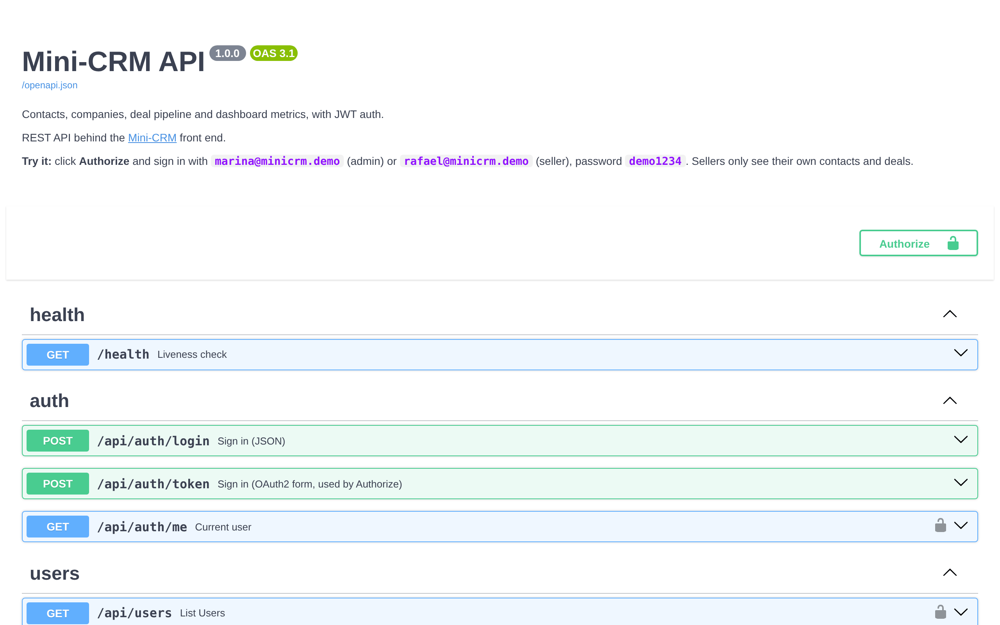
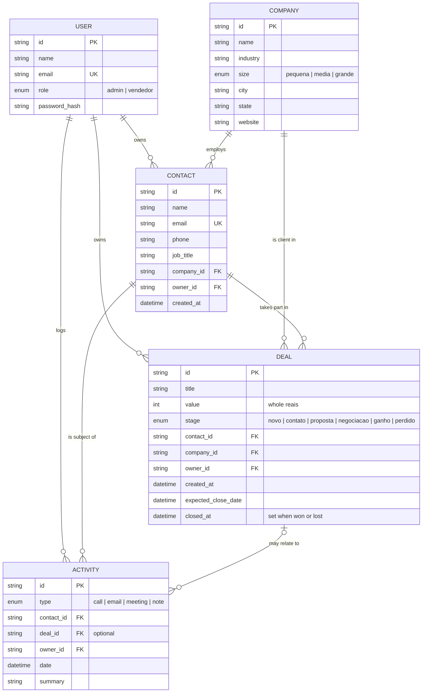
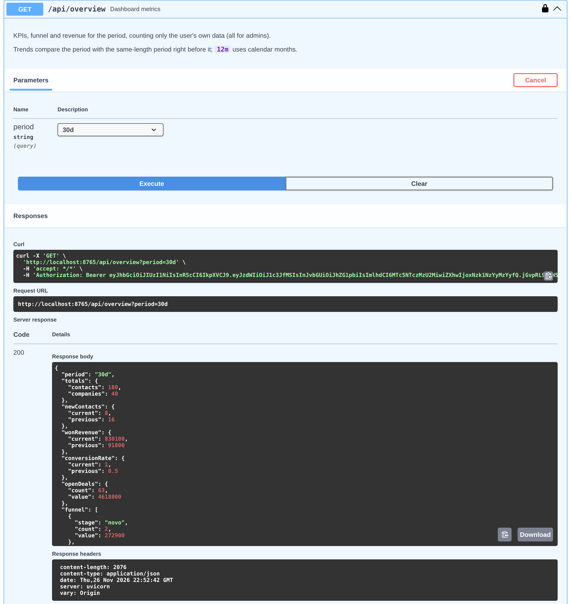
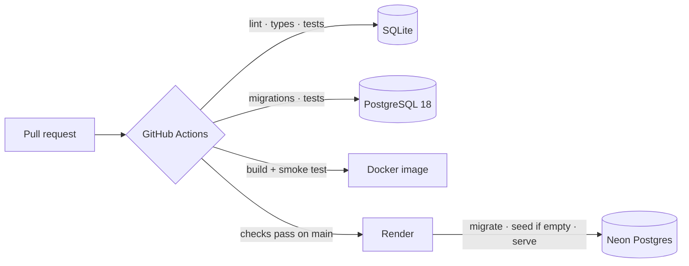

# Mini-CRM API

[](https://github.com/vidalicaro-byte/mini-crm-api/actions/workflows/ci.yml)


[](LICENSE)

**English** · [Português](README.pt-BR.md)

REST API for the [Mini-CRM](https://github.com/vidalicaro-byte/mini-crm) front end: contacts,
companies, a deal pipeline and dashboard metrics, with JWT authentication and per-user data access.
It implements the contract the front end was built against
([`src/api/schemas.ts`](https://github.com/vidalicaro-byte/mini-crm/blob/main/src/api/schemas.ts)),
so the same screens can run on mock data or on this server.

**Live app:** https://mini-crm-ten-coral.vercel.app (the Mini-CRM front end, running on this API)

**Live docs:** https://mini-crm-api-7qw0.onrender.com/docs
(free plan: the first request after a pause takes about a minute while the service wakes up)

**Try it:** click **Authorize** and sign in with one of the demo users. They share the password `demo1234`.

| User | Role | Sees |
| --- | --- | --- |
| `marina@minicrm.demo` | admin | everything, plus the user list |
| `rafael@minicrm.demo` | seller | only his own contacts, deals and activities |



## Highlights

- **Contract-first.** Every route, field name (camelCase), error message and edge case matches the
  front end's contract. The test suite checks the dashboard numbers against a Python port of the front end's mock.
- **Access rules in one place.** Sellers only see what they own; admins see everything. Records
  outside the user's scope answer **404, not 403**, so their IDs can't be probed.
- **Aggregation in SQL.** The dashboard (KPIs against the previous period, funnel, monthly
  revenue) is computed with `COUNT(...) FILTER (WHERE ...)` and `CASE` buckets in a few queries,
  not by loading rows into Python. Lists avoid N+1 queries: relationships are `lazy="raise"`, so a
  forgotten `joinedload` fails the tests instead of slowing production.
- **Brazilian Portuguese sorting on both databases.** `Ágata` sorts next to `Agnes`: an ICU
  collation on PostgreSQL and an equivalent custom collation on SQLite, both held to the same tests.
- **Tested on two databases.** 169 tests, 99% coverage, run on SQLite (fast, local) and on
  PostgreSQL 18 (CI), each test isolated in a rolled-back transaction.
- **Production-shaped.** Alembic migrations checked against the models in CI, a non-root multi-stage
  Docker image, a Render Blueprint (infrastructure as code) and serverless Postgres on Neon.
  Each deploy runs only after CI passes, and a scheduled workflow resets the public demo data every night.

## Stack

| Concern | Choice | Why |
| --- | --- | --- |
| Web framework | **FastAPI** | Typed request handling, dependency injection and OpenAPI docs generated from the code |
| Validation | **Pydantic v2** | The same models validate input, shape output and document the schema |
| Database | **PostgreSQL** (Neon) · SQLite in development | Postgres in production; SQLite means nothing to install locally (no Docker needed) |
| ORM and migrations | **SQLAlchemy 2.1** + **Alembic** | Typed `Mapped[...]` models; versioned, reviewable schema changes |
| Auth | **JWT** (PyJWT) + **Argon2** (pwdlib) | Stateless tokens; the currently recommended password hash |
| Tests | **pytest** + httpx | Fixtures, transaction-per-test isolation, coverage |
| Quality | **Ruff**, **mypy** (strict), pre-commit | Lint and format in one fast tool; strict types across `src` and `tests` |
| Packaging | **uv** | Lockfile, reproducible installs, fast CI |
| Delivery | **Docker**, **GitHub Actions**, **Render** | The same image in CI and production; deploys wait for green checks |

## Data model



## Endpoints

All routes except `/health` and the sign-in routes require `Authorization: Bearer <token>`.

| Method | Path | Notes |
| --- | --- | --- |
| `POST` | `/api/auth/login` | `{email, password}` → `{token, user}`. The token is valid for 8 hours |
| `POST` | `/api/auth/token` | Same, as an OAuth2 form (used by the docs' **Authorize** button) |
| `GET` | `/api/auth/me` | The signed-in user |
| `GET` | `/api/users` | Admins only (403 for sellers) |
| `GET` | `/api/contacts` | Search `q`, filter `companyId`, `sort` by `name`/`email`/`company`/`createdAt`, `order`, `page`, `pageSize` (max 100) |
| `GET` | `/api/contacts/{id}` | With the company |
| `POST` | `/api/contacts` | 201 + `Location`. The creator becomes the owner. 409 if the e-mail is taken |
| `PATCH` | `/api/contacts/{id}` | Partial update: only the fields sent change |
| `GET` | `/api/companies` | Search, filter by `size`, sort by any column including `contactsCount` and `openDealsValue` |
| `GET` | `/api/companies/{id}` | With `contactsCount` and `openDeals {count, value}` |
| `GET` | `/api/deals` | Newest first. By default the whole visible pipeline comes in one page, for the board. Filter by `contactId`/`companyId` |
| `PATCH` | `/api/deals/{id}` | `{stage}`. Moving to won/lost stamps `closedAt`; reopening clears it |
| `GET` | `/api/activities?contactId=` | A contact's timeline, newest first |
| `GET` | `/api/overview?period=` | `7d`, `30d`, `90d` or `12m`: KPIs with the previous period, funnel and revenue |
| `GET` | `/health` | Liveness check (also answers `HEAD`) |

Companies are visible to everyone, but their counts only include what the viewer may see.



### Errors

Every error has the same shape, with a message the front end can show as is (in Portuguese, like
the UI). Validation errors also list the fields:

```json
{
  "message": "Informe um e-mail válido.",
  "errors": [{ "field": "email", "message": "Informe um e-mail válido." }]
}
```

| Status | When |
| --- | --- |
| 401 | Missing, invalid or expired token |
| 403 | A seller calls an admin-only route |
| 404 | The record doesn't exist **or** belongs to another seller |
| 409 | Unique conflict (contact e-mail) |
| 422 | Invalid input, with the same messages as the front end's form |

## Running locally

Requires [uv](https://docs.astral.sh/uv/), which installs the right Python by itself. No database
server is needed: development uses a SQLite file.

```powershell
git clone https://github.com/vidalicaro-byte/mini-crm-api.git
cd mini-crm-api
uv sync
uv run alembic upgrade head      # create the tables (crm.db)
uv run python -m crm_api.seed    # load the demo data (running it again resets the data)
uv run fastapi dev src/crm_api/main.py
```

Open http://127.0.0.1:8000/docs. To use PostgreSQL instead, set `DATABASE_URL` (see `.env.example`).

### Tests and checks

```powershell
uv run pytest                 # 169 tests on SQLite, a few seconds
uv run ruff check .
uv run ruff format --check .
uv run mypy
uv run alembic check          # models and migrations agree
```

To run the same suite on PostgreSQL, point `TEST_DATABASE_URL` at an empty database. CI does this
on every push, with a PostgreSQL 18 service container. `uv run pre-commit install` runs the checks
on each commit and enforces [Conventional Commits](https://www.conventionalcommits.org/) messages.

## Deployment



- **Docker:** multi-stage build with uv; the runtime image has no build tools and runs as a non-root
  user. On start it applies migrations, loads the demo data if the database is empty, and serves on
  `$PORT`.
- **Render** (free plan) builds the image from [`render.yaml`](render.yaml). Render generates the
  JWT secret, the database URLs are set in its dashboard, and auto-deploy waits for CI.
- **Neon** hosts PostgreSQL. The app connects through the pooler; migrations use the direct
  connection, because schema changes don't work well through a transaction pooler.
- **Nightly reset:** the demo is public and writable, so a scheduled GitHub Actions workflow
  ([`reset-demo.yml`](.github/workflows/reset-demo.yml)) reloads the demo data every night at 03:00
  (São Paulo), moving the dates forward. It can also be run by hand from the Actions tab.
- In production the app refuses to start with the development JWT secret or with one shorter than
  32 characters.

## Project structure

```text
src/crm_api/
├── main.py         # app factory: routers, CORS, error handlers, docs
├── config.py       # settings from environment variables (pydantic-settings)
├── db.py           # engine, sessions, SQLite/Postgres specifics
├── models.py       # SQLAlchemy models
├── schemas.py      # Pydantic request/response models (camelCase JSON)
├── security.py     # password hashing and JWT
├── deps.py         # dependencies: session, current user, admin guard
├── access.py       # who can see what
├── errors.py       # {"message"} error format and OpenAPI error docs
├── overview.py     # dashboard aggregation
├── text.py         # pt-BR collation shared by both databases
├── routers/        # one module per resource
└── seed/           # demo data (shared with the front end) and loader
migrations/         # Alembic
tests/              # pytest, one file per area
```

## Design decisions

- **Sync SQLAlchemy, not async.** Each request runs a few short queries, so a thread pool is plenty.
  Sync code is simpler to write, test and debug, and FastAPI runs sync routes in threads.
- **404 instead of 403 for other sellers' records.** A 403 confirms the record exists; a 404 doesn't.
- **SQLite for development, PostgreSQL for production, tests on both.** Local setup needs nothing
  installed, and CI catches dialect differences. Database-specific behavior (sorting, `lower()` on
  accented text, savepoints) is handled explicitly in `db.py` and `text.py`.
- **Demo data relative to today.** The seed stores dates relative to a reference day and shifts
  them on load, so the dashboard always shows recent activity.
- **Clean OpenAPI.** Operation IDs are the function names (`list_contacts`) and each error status
  has its own example, so clients generated from `/openapi.json` read well.

## Limitations and roadmap

- No refresh tokens or logout: a token lives for 8 hours. Revocation would need a denylist or
  short-lived tokens.
- No rate limiting on sign-in yet.
- Contacts and deals can't be deleted (the front end doesn't offer it).
- Everything a visitor changes on the live demo is visible to other visitors until the nightly reset.

## License

[MIT](LICENSE)
