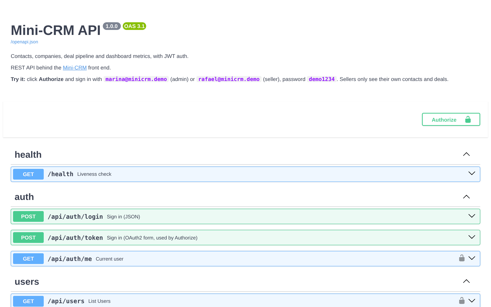
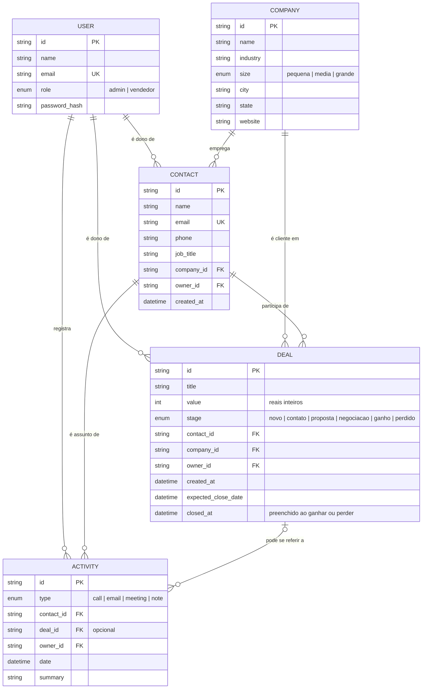
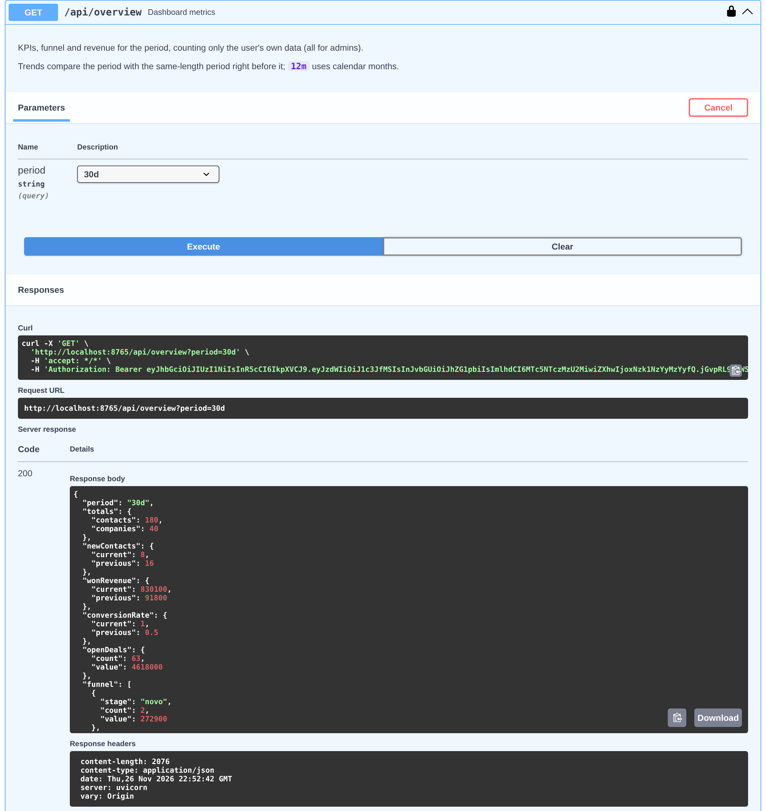
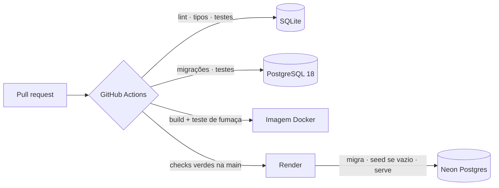

# Mini-CRM API

[](https://github.com/vidalicaro-byte/mini-crm-api/actions/workflows/ci.yml)


[](LICENSE)

[English](README.md) · **Português**

API REST do front-end [Mini-CRM](https://github.com/vidalicaro-byte/mini-crm): contatos, empresas,
funil de negócios e métricas do painel, com autenticação JWT e acesso aos dados por usuário.
Ela implementa o contrato usado na construção do front-end
([`src/api/schemas.ts`](https://github.com/vidalicaro-byte/mini-crm/blob/main/src/api/schemas.ts)),
então as mesmas telas funcionam com dados simulados ou com este servidor.

**Documentação ao vivo:** https://mini-crm-api-7qw0.onrender.com/docs
(plano gratuito: a primeira requisição depois de uma pausa leva cerca de um minuto, enquanto o serviço acorda)

**Experimente:** clique em **Authorize** e entre com um dos usuários de demonstração. A senha de
todos é `demo1234`.

| Usuário | Papel | Vê |
| --- | --- | --- |
| `marina@minicrm.demo` | admin | tudo, inclusive a lista de usuários |
| `rafael@minicrm.demo` | vendedor | só os próprios contatos, negócios e atividades |



## Destaques

- **Contrato primeiro.** Rotas, nomes de campos (camelCase), mensagens de erro e casos de borda
  seguem o contrato do front-end. Os testes conferem os números do painel com uma versão em Python
  do mock do front-end.
- **Regras de acesso num lugar só.** Vendedores só veem o que é deles; admins veem tudo. Registros
  fora do alcance do usuário respondem **404, e não 403**, para que não dê para sondar IDs.
- **Agregação no SQL.** O painel (KPIs comparados ao período anterior, funil e receita mensal) é
  calculado com `COUNT(...) FILTER (WHERE ...)` e faixas com `CASE` em poucas consultas, sem
  carregar linhas no Python. As listas evitam consultas N+1: os relacionamentos são `lazy="raise"`,
  então um `joinedload` esquecido quebra os testes em vez de deixar a produção lenta.
- **Ordenação em português nos dois bancos.** `Ágata` fica ao lado de `Agnes`: collation ICU no
  PostgreSQL e uma collation equivalente feita sob medida no SQLite, as duas cobertas pelos mesmos testes.
- **Testada em dois bancos.** 169 testes e 99% de cobertura, rodando no SQLite (rápido, local) e no
  PostgreSQL 18 (CI), cada teste isolado numa transação desfeita no final.
- **Pronta para produção.** Migrações Alembic conferidas com os modelos no CI, imagem Docker
  multi-stage sem root, Blueprint do Render (infraestrutura como código) e Postgres serverless no
  Neon. Cada deploy só roda depois que o CI passa.

## Stack

| Área | Escolha | Por quê |
| --- | --- | --- |
| Framework web | **FastAPI** | Requisições tipadas, injeção de dependências e documentação OpenAPI gerada pelo código |
| Validação | **Pydantic v2** | Os mesmos modelos validam a entrada, formatam a saída e documentam o schema |
| Banco de dados | **PostgreSQL** (Neon) · SQLite no desenvolvimento | Postgres em produção; com SQLite não há nada para instalar localmente (sem Docker) |
| ORM e migrações | **SQLAlchemy 2.1** + **Alembic** | Modelos tipados com `Mapped[...]`; mudanças de schema versionadas e revisáveis |
| Autenticação | **JWT** (PyJWT) + **Argon2** (pwdlib) | Tokens sem estado; o hash de senha recomendado hoje |
| Testes | **pytest** + httpx | Fixtures, isolamento por transação, cobertura |
| Qualidade | **Ruff**, **mypy** (strict), pre-commit | Lint e formatação numa ferramenta rápida; tipagem estrita em `src` e `tests` |
| Pacotes | **uv** | Lockfile, instalações reproduzíveis, CI rápido |
| Entrega | **Docker**, **GitHub Actions**, **Render** | A mesma imagem no CI e em produção; o deploy espera os checks passarem |

## Modelo de dados



## Endpoints

Todas as rotas, exceto `/health` e as de login, exigem `Authorization: Bearer <token>`.

| Método | Caminho | Observações |
| --- | --- | --- |
| `POST` | `/api/auth/login` | `{email, password}` → `{token, user}`. O token vale por 8 horas |
| `POST` | `/api/auth/token` | O mesmo, como formulário OAuth2 (usado pelo botão **Authorize** da documentação) |
| `GET` | `/api/auth/me` | O usuário logado |
| `GET` | `/api/users` | Só admins (403 para vendedores) |
| `GET` | `/api/contacts` | Busca `q`, filtro `companyId`, `sort` por `name`/`email`/`company`/`createdAt`, `order`, `page`, `pageSize` (máx. 100) |
| `GET` | `/api/contacts/{id}` | Com a empresa |
| `POST` | `/api/contacts` | 201 + `Location`. Quem cria vira o dono. 409 se o e-mail já existe |
| `PATCH` | `/api/contacts/{id}` | Atualização parcial: só mudam os campos enviados |
| `GET` | `/api/companies` | Busca, filtro por `size`, ordenação por qualquer coluna, inclusive `contactsCount` e `openDealsValue` |
| `GET` | `/api/companies/{id}` | Com `contactsCount` e `openDeals {count, value}` |
| `GET` | `/api/deals` | Mais recentes primeiro. Por padrão o funil visível inteiro vem numa página só, para o quadro. Filtros `contactId`/`companyId` |
| `PATCH` | `/api/deals/{id}` | `{stage}`. Mover para ganho/perdido preenche `closedAt`; reabrir limpa |
| `GET` | `/api/activities?contactId=` | A linha do tempo de um contato, mais recentes primeiro |
| `GET` | `/api/overview?period=` | `7d`, `30d`, `90d` ou `12m`: KPIs com o período anterior, funil e receita |
| `GET` | `/health` | Verificação de disponibilidade (também responde a `HEAD`) |

Empresas são visíveis para todos, mas os números delas só contam o que o usuário pode ver.



### Erros

Todo erro tem o mesmo formato, com uma mensagem que o front-end pode mostrar direto. Erros de
validação também listam os campos:

```json
{
  "message": "Informe um e-mail válido.",
  "errors": [{ "field": "email", "message": "Informe um e-mail válido." }]
}
```

| Status | Quando |
| --- | --- |
| 401 | Token ausente, inválido ou expirado |
| 403 | Um vendedor chama uma rota só de admin |
| 404 | O registro não existe **ou** é de outro vendedor |
| 409 | Conflito de unicidade (e-mail do contato) |
| 422 | Entrada inválida, com as mesmas mensagens do formulário do front-end |

## Rodando localmente

Requer o [uv](https://docs.astral.sh/uv/), que instala o Python certo sozinho. Não precisa de
servidor de banco: o desenvolvimento usa um arquivo SQLite.

```powershell
git clone https://github.com/vidalicaro-byte/mini-crm-api.git
cd mini-crm-api
uv sync
uv run alembic upgrade head      # cria as tabelas (crm.db)
uv run python -m crm_api.seed    # carrega os dados de demonstração (rodar de novo reinicia os dados)
uv run fastapi dev src/crm_api/main.py
```

Abra http://127.0.0.1:8000/docs. Para usar PostgreSQL, defina `DATABASE_URL` (veja `.env.example`).

### Testes e verificações

```powershell
uv run pytest                 # 169 testes no SQLite, poucos segundos
uv run ruff check .
uv run ruff format --check .
uv run mypy
uv run alembic check          # modelos e migrações batem
```

Para rodar os mesmos testes no PostgreSQL, aponte `TEST_DATABASE_URL` para um banco vazio. O CI faz
isso a cada push, com um contêiner de serviço PostgreSQL 18. `uv run pre-commit install` roda as
verificações a cada commit e exige mensagens no padrão
[Conventional Commits](https://www.conventionalcommits.org/pt-br/).

## Deploy



- **Docker:** build multi-stage com uv; a imagem final não tem ferramentas de build e roda sem root.
  Ao iniciar, aplica as migrações, carrega os dados de demonstração se o banco estiver vazio e
  serve na porta `$PORT`.
- **Render** (plano gratuito) monta a imagem a partir do [`render.yaml`](render.yaml). O Render gera
  o segredo do JWT, as URLs do banco ficam no painel dele, e o deploy automático espera o CI.
- **Neon** hospeda o PostgreSQL. A aplicação conecta pelo pooler; as migrações usam a conexão
  direta, porque mudanças de schema não funcionam bem através de um pooler de transações.
- Em produção a aplicação se recusa a iniciar com o segredo JWT de desenvolvimento ou com um de
  menos de 32 caracteres.

## Estrutura do projeto

```text
src/crm_api/
├── main.py         # fábrica da app: routers, CORS, tratamento de erros, docs
├── config.py       # configurações via variáveis de ambiente (pydantic-settings)
├── db.py           # engine, sessões, particularidades de SQLite/Postgres
├── models.py       # modelos SQLAlchemy
├── schemas.py      # modelos Pydantic de requisição/resposta (JSON em camelCase)
├── security.py     # hash de senha e JWT
├── deps.py         # dependências: sessão, usuário atual, guarda de admin
├── access.py       # quem pode ver o quê
├── errors.py       # formato de erro {"message"} e documentação dos erros no OpenAPI
├── overview.py     # agregação do painel
├── text.py         # collation pt-BR compartilhada pelos dois bancos
├── routers/        # um módulo por recurso
└── seed/           # dados de demonstração (compartilhados com o front-end) e carregador
migrations/         # Alembic
tests/              # pytest, um arquivo por área
```

## Decisões de projeto

- **SQLAlchemy síncrono, não async.** Cada requisição faz poucas consultas curtas, então um pool de
  threads basta. Código síncrono é mais simples de escrever, testar e depurar, e o FastAPI roda
  rotas síncronas em threads.
- **404 em vez de 403 para registros de outros vendedores.** Um 403 confirma que o registro existe;
  um 404, não.
- **SQLite no desenvolvimento, PostgreSQL em produção, testes nos dois.** Não é preciso instalar
  nada localmente, e o CI pega diferenças entre os bancos. Os comportamentos específicos de cada
  banco (ordenação, `lower()` com acentos, savepoints) são tratados explicitamente em `db.py` e `text.py`.
- **Dados de demonstração relativos a hoje.** O seed guarda as datas em relação a um dia de
  referência e as desloca ao carregar, então o painel sempre mostra atividade recente.
- **OpenAPI caprichado.** Os IDs das operações são os nomes das funções (`list_contacts`) e cada
  status de erro tem seu próprio exemplo, então clientes gerados a partir do `/openapi.json` ficam legíveis.

## Limitações e próximos passos

- Sem refresh token nem logout: um token vale por 8 horas. Revogar exigiria uma lista de bloqueio ou
  tokens de vida curta.
- Ainda sem limite de tentativas no login.
- Contatos e negócios não podem ser excluídos (o front-end não oferece isso).
- Próximo: ligar o front-end do Mini-CRM a esta API e reiniciar os dados de demonstração toda noite.

## Licença

[MIT](LICENSE)
